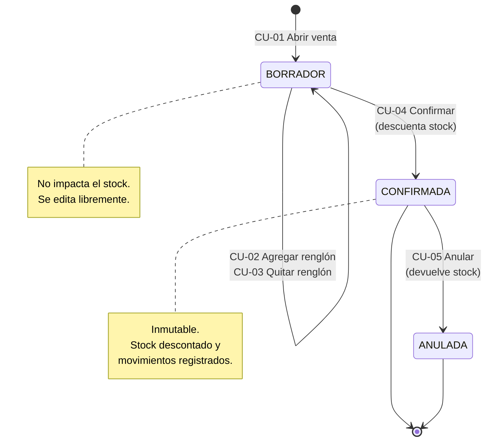

# Clientes y flujo de ventas — Campos, casos de uso y pantallas

Workshop 5 · Checkpoint 1 · Team **grupo21**

---

## 1. Campos de la tabla `cliente`

| Campo | Tipo | Obligatorio | Único | Observación |
| --- | --- | --- | --- | --- |
| `id` | Entero | Sí | Sí | Clave primaria, se genera automáticamente |
| `razon_social` | Texto (150) | Sí | No | Nombre de la empresa o de la persona. Es lo único realmente obligatorio |
| `documento` | Texto (20) | No | **Sí** | CUIT o DNI. Ver la aclaración de abajo |
| `email` | Texto (150) | No | No | Para enviar comprobantes y presupuestos |
| `telefono` | Texto (30) | No | No | El dato más usado en la práctica: la mayoría de los pedidos entran por teléfono |
| `direccion` | Texto (200) | No | No | Domicilio de entrega o facturación |
| `activo` | Booleano | Sí | No | Baja lógica, por defecto `true` |
| `creado_en` | Fecha y hora | Sí | No | Auditoría: desde cuándo es cliente |
| `actualizado_en` | Fecha y hora | Sí | No | Auditoría: última modificación |

### Por qué el documento es opcional pero único

Es la decisión menos obvia del modelo, y la más fácil de errar.

**Opcional**, porque en una venta de mostrador nadie pide el CUIT: si fuera obligatorio, el vendedor cargaría cualquier número con tal de avanzar, y la base terminaría llena de datos inventados.

**Único**, porque si se carga, no puede repetirse: dos fichas del mismo cliente parten su historial en dos y rompen cualquier informe de cuánto compró.

Esa combinación obliga a tratar un caso que suele romper los sistemas: **varios clientes sin documento tienen que convivir sin chocar entre sí**. Está contemplado y verificado — si el chequeo estuviera mal hecho, el segundo "Consumidor Final" sería rechazado por colisionar contra un documento vacío.

### Campos que decidimos NO incluir

- **Límite de crédito y condición de pago** — pertenecen a cuenta corriente, que no está en el alcance del TP.
- **Condición frente al IVA** — hace falta recién al facturar, y la facturación electrónica está fuera de alcance.
- **Vendedor asignado** — tiene sentido con una fuerza de ventas grande; acá agregaría una relación sin uso real.

---

## 2. CRUD de clientes

Implementado en `erp/vistas/clientes.py`. Mismo patrón que productos y usuarios.

| Operación | Ruta | Qué hace |
| --- | --- | --- |
| **Create** | `GET/POST /clientes/nuevo` | Alta con validación de documento único |
| **Read** | `GET /clientes/` | Listado con búsqueda por razón social, documento o email |
| **Update** | `GET/POST /clientes/<id>/editar` | Edición con datos precargados |
| **Delete** | `GET/POST /clientes/<id>/baja` | **Baja lógica** con confirmación previa |
| — | `POST /clientes/<id>/reactivar` | Revierte la baja |

### Validaciones

| Campo | Regla | Mensaje |
| --- | --- | --- |
| `razon_social` | Mínimo 2 caracteres | "Debe tener al menos 2 caracteres" |
| `documento` | Solo números y guiones | "Solo números y guiones (ej: 30-71234567-8)" |
| `documento` | No repetido | "Ya hay un cliente con ese documento" |
| `email` | Formato plausible | "No parece una dirección de correo válida" |

La baja es lógica porque **las ventas históricas apuntan al cliente**: borrarlo dejaría esas ventas sin titular. La clave foránea usa `ON DELETE RESTRICT`, así que la base misma impide el borrado accidental.

---

## 3. Casos de uso del flujo de ventas

Actores: **Vendedor** (registra las ventas), **Administrador** (todo), **Sistema** (valida y descuenta stock).

### Resumen

| # | Caso de uso | Actor | Estado |
| --- | --- | --- | --- |
| CU-01 | Abrir una venta | Vendedor | ✅ Implementado |
| CU-02 | Agregar un producto a la venta | Vendedor | ✅ Implementado |
| CU-03 | Quitar un renglón del borrador | Vendedor | ✅ Implementado |
| CU-04 | Confirmar la venta (descuenta stock) | Vendedor | ✅ Implementado |
| CU-05 | Anular una venta confirmada | Administrador | ✅ Implementado |
| CU-06 | Consultar el historial de ventas | Vendedor | ✅ Implementado |
| CU-07 | Consultar la trazabilidad de stock de una venta | Administrador | ✅ Implementado |
| CU-08 | Dar de alta un cliente durante la venta | Vendedor | ✅ Implementado |

---

### CU-01 · Abrir una venta

| | |
| --- | --- |
| **Actor** | Vendedor |
| **Disparador** | Un cliente hace un pedido |
| **Precondición** | El vendedor tiene sesión iniciada y existe al menos un cliente activo |
| **Postcondición** | Existe una venta en estado BORRADOR, sin impacto en el stock |

**Flujo principal**
1. El vendedor entra a *Ventas → Nueva venta*.
2. El sistema muestra la lista de clientes **activos**.
3. El vendedor elige el cliente y, si quiere, escribe una observación.
4. El sistema crea la venta en estado BORRADOR y abre su pantalla de detalle.

**Flujos alternativos**
- **3a. No eligió cliente** → el sistema rechaza con "Elegí un cliente".
- **2a. No hay clientes activos** → el sistema ofrece un enlace para cargar uno (ver CU-08).

---

### CU-02 · Agregar un producto a la venta

| | |
| --- | --- |
| **Actor** | Vendedor |
| **Precondición** | La venta está en estado BORRADOR |
| **Postcondición** | La venta tiene un renglón más y su total recalculado. **El stock no se toca todavía** |

**Flujo principal**
1. El vendedor elige un producto de la lista y escribe la cantidad.
2. El sistema verifica que el producto esté activo y que haya stock suficiente.
3. El sistema **copia el precio vigente** del producto al renglón.
4. El sistema calcula el subtotal y recalcula el total de la venta.

**Flujos alternativos**
- **2a. Stock insuficiente** → "Stock insuficiente de PRD-004: hay 8.00 y se piden 999".
- **2b. Producto dado de baja** → "PRD-006 está dado de baja y no puede venderse".
- **2c. El producto ya está en la venta** → "Ya está en la venta. Editá la cantidad del renglón".
- **1a. Cantidad cero o negativa** → "La cantidad debe ser mayor a 0".
- **0a. La venta ya está confirmada** → "La venta ya está confirmada: no admite cambios".

> **Por qué se copia el precio en lugar de referenciarlo:** si mañana sube el precio del producto, las ventas de ayer tienen que seguir valiendo lo que valieron. Un sistema que recalcula el pasado no sirve para rendir cuentas.

---

### CU-03 · Quitar un renglón del borrador

| | |
| --- | --- |
| **Actor** | Vendedor |
| **Precondición** | La venta está en BORRADOR y tiene al menos un renglón |
| **Postcondición** | El renglón desaparece y el total se recalcula |

**Flujo alternativo**
- **La venta está confirmada** → el sistema lo impide. Una venta confirmada es historia, no un borrador.

---

### CU-04 · Confirmar la venta

El caso de uso central: es donde el stock se mueve.

| | |
| --- | --- |
| **Actor** | Vendedor |
| **Precondición** | La venta está en BORRADOR y tiene al menos un renglón |
| **Postcondición** | La venta queda CONFIRMADA e inmutable, el stock descontado y los movimientos registrados |

**Flujo principal**
1. El vendedor presiona *Confirmar venta*.
2. El sistema abre una transacción.
3. Para cada renglón:
   a. **Bloquea la fila del producto** (`SELECT ... FOR UPDATE`).
   b. Vuelve a verificar que el stock alcance.
   c. Descuenta la cantidad.
   d. Registra un movimiento de tipo EGRESO con el stock resultante.
4. Marca la venta como CONFIRMADA y guarda la fecha.
5. Confirma la transacción.

**Flujos alternativos**
- **1a. Venta sin renglones** → "No se puede confirmar una venta sin renglones".
- **3b. Stock insuficiente al confirmar** → se deshace **todo**: ni stock descontado a medias ni venta registrada.
- **1b. Ya estaba confirmada** → "La venta ya estaba confirmada".
- **1c. Está anulada** → "Una venta anulada no puede confirmarse".

> **Por qué se vuelve a verificar el stock** si ya se verificó al agregar el renglón: entre que se armó el borrador y se confirmó pueden haber pasado horas, y otra persona pudo haber vendido las mismas unidades.
>
> **Por qué se bloquea la fila:** sin eso, dos ventas confirmadas al mismo instante leen el mismo stock y venden más de lo que hay. Es el motivo por el que a veces una tienda online te vende algo que no tiene.

---

### CU-05 · Anular una venta confirmada

| | |
| --- | --- |
| **Actor** | Administrador |
| **Precondición** | La venta está CONFIRMADA |
| **Postcondición** | La venta queda ANULADA, el stock devuelto y los movimientos inversos registrados |

**Flujo principal**
1. El administrador abre la venta y presiona *Anular*.
2. El sistema pide confirmación explicando qué va a pasar.
3. Por cada renglón: devuelve la cantidad al stock y registra un movimiento INGRESO con origen ANULACION.
4. Marca la venta como ANULADA y guarda la fecha.

**Flujos alternativos**
- **1a. La venta está en BORRADOR** → "Solo se puede anular una venta confirmada".
- **1b. Ya estaba anulada** → mismo mensaje. No se anula dos veces.

> **La venta no se borra ni se edita.** Quedan registradas las dos operaciones —la venta y su anulación— con sus fechas. Si el historial se pudiera reescribir hacia atrás, no serviría para nada.

---

### CU-06 · Consultar el historial de ventas

| | |
| --- | --- |
| **Actor** | Vendedor |
| **Flujo** | Entra a *Ventas*, ve el listado con número, fecha, cliente, cantidad de renglones, total y estado. Puede filtrar por estado |

Las anuladas se muestran atenuadas: siguen ahí, pero se distinguen de un vistazo.

---

### CU-07 · Consultar la trazabilidad de stock de una venta

| | |
| --- | --- |
| **Actor** | Administrador |
| **Precondición** | La venta fue confirmada alguna vez |
| **Flujo** | Abre la venta y, al pie, ve cada movimiento de stock que generó: producto, tipo, cantidad y **stock resultante** en ese momento |

Es lo que permite responder "¿por qué este producto tiene 110 y no 120?" sin tener que deducirlo.

---

### CU-08 · Dar de alta un cliente durante la venta

| | |
| --- | --- |
| **Actor** | Vendedor |
| **Disparador** | Llama un cliente nuevo y quiere comprar ahora |
| **Precondición** | El vendedor está en la pantalla de nueva venta |
| **Postcondición** | El cliente queda creado y **ya seleccionado** en la venta |

**Flujo principal**
1. En la pantalla de nueva venta, el vendedor ve que el cliente no está en la lista.
2. Presiona *Cargalo ahora*.
3. El sistema abre el alta de cliente recordando de dónde vino.
4. El vendedor completa los datos y guarda.
5. El sistema vuelve a la pantalla de venta **con el cliente nuevo ya elegido** en el desplegable.

**Flujos alternativos**
- **4a. Datos inválidos** → el formulario se vuelve a mostrar con los errores, sin perder el destino de vuelta.
- **4b. El vendedor cancela** → vuelve a la pantalla de venta sin crear nada.

> **Detalle de seguridad:** el destino de vuelta viaja en la URL, así que se valida que sea una ruta interna. Sin ese control, un enlace preparado podría usar el formulario de alta como trampolín hacia otro sitio. Verificado: un destino `https://...` externo se ignora y manda al listado de clientes.

---

## 4. Diagrama del flujo completo



---

## 5. Pantallas de venta

### 5.1 Listado de ventas

```
┌──────────────────────────────────────────────────────────────────────────┐
│ ERP grupo21   Productos │ Clientes │ Ventas │ Usuarios    Santiago · Salir│
├──────────────────────────────────────────────────────────────────────────┤
│  Ventas                                              [ + Nueva venta ]   │
│  2 ventas                                                                │
│  ┌────────────────────┐ ┌──────────┐                                     │
│  │ Todos los estados ▾│ │ Filtrar  │                                     │
│  └────────────────────┘ └──────────┘                                     │
│  ┌─────┬──────────────┬───────────────────────┬──────┬─────────┬───────┐ │
│  │  #  │ FECHA        │ CLIENTE               │ RENG │   TOTAL │ ESTADO│ │
│  ├─────┼──────────────┼───────────────────────┼──────┼─────────┼───────┤ │
│  │ #2  │ 25/09 22:16  │ Distribuidora Sta Fe  │   0  │   $0,00 │(Borr.)│ │
│  │ #1  │ 25/09 22:14  │ Metalúrgica Litoral   │   3  │$462.762 │(Anul.)│ │
│  └─────┴──────────────┴───────────────────────┴──────┴─────────┴───────┘ │
└──────────────────────────────────────────────────────────────────────────┘
```

### 5.2 Nueva venta — elegir cliente

```
┌────────────────────────────────────────────────────┐
│  Ventas / Nueva venta                              │
│                                                    │
│  Elegí el cliente. Después vas a poder agregar     │
│  los productos.                                    │
│                                                    │
│  Cliente *                                         │
│  ┌──────────────────────────────────────────────┐  │
│  │ Metalúrgica del Litoral — 30-71234567-8    ▾ │  │
│  └──────────────────────────────────────────────┘  │
│                                                    │
│  Observaciones                                     │
│  ┌──────────────────────────────────────────────┐  │
│  │ Pedido telefónico                            │  │
│  └──────────────────────────────────────────────┘  │
│                                                    │
│  [ Abrir venta ]   Cancelar                        │
└────────────────────────────────────────────────────┘
```

Solo aparecen clientes **activos**: no tiene sentido ofrecer a quien fue dado de baja.

### 5.3 Pantalla de venta — borrador

La pantalla principal del módulo.

```
┌──────────────────────────────────────────────────────────────────────────┐
│  Ventas / Venta #3                                                       │
│                                                                          │
│  Venta #3  (BORRADOR)                                                    │
│  Metalúrgica del Litoral S.A. · 30-71234567-8 · 30/10/2026 14:22         │
│                                                                          │
│  ┌──────────────────────────────────────┐ ┌───────┐ ┌──────────┐         │
│  │ PRD-001 — Chapa (120 disp · $18.500)▾│ │   10  │ │ Agregar  │         │
│  └──────────────────────────────────────┘ └───────┘ └──────────┘         │
│                                                                          │
│  ┌──────────┬────────────────────┬──────────┬────────────┬────────────┐  │
│  │ CÓDIGO   │ PRODUCTO           │ CANTIDAD │ PRECIO U.  │  SUBTOTAL  │  │
│  ├──────────┼────────────────────┼──────────┼────────────┼────────────┤  │
│  │ PRD-001  │ Chapa galvanizada  │       10 │ $18.500,00 │ $185.000,00│ Quitar │
│  │ PRD-002  │ Perfil C 100x50    │       25 │  $9.750,50 │ $243.762,50│ Quitar │
│  ├──────────┴────────────────────┴──────────┴────────────┼────────────┤  │
│  │                                                 TOTAL │ $428.762,50│  │
│  └────────────────────────────────────────────────────────┴───────────┘  │
│                                                                          │
│  [ Confirmar venta ]  Al confirmar se descuenta el stock y la venta ya   │
│                       no se puede editar.                                │
└──────────────────────────────────────────────────────────────────────────┘
```

**Decisiones de esta pantalla:**

- El selector de productos muestra **stock disponible y precio** en la misma línea: el vendedor no tiene que ir a otra pantalla a averiguarlos mientras habla por teléfono.
- Solo lista productos **activos y con stock mayor a cero**.
- El total se recalcula solo con cada renglón.
- El botón *Confirmar* está deshabilitado mientras no haya renglones, y la advertencia de que la acción es irreversible está **al lado del botón**, no escondida en un manual.

### 5.4 Pantalla de venta — confirmada

Los mismos datos, con tres diferencias:

1. Desaparece el formulario para agregar productos y los botones *Quitar*.
2. El botón *Confirmar* se reemplaza por *Anular venta*, en rojo.
3. Aparece al pie la tabla de **movimientos de stock** generados.

```
│  Movimientos de stock                                                    │
│  Cada unidad que entró o salió por esta venta, con el stock que quedó.   │
│  ┌──────────────┬──────────┬──────────┬────────┬──────────┬───────────┐  │
│  │ FECHA        │ PRODUCTO │ TIPO     │ ORIGEN │ CANTIDAD │ STOCK RES.│  │
│  ├──────────────┼──────────┼──────────┼────────┼──────────┼───────────┤  │
│  │ 30/10 14:25  │ PRD-001  │ (Egreso) │ venta  │       10 │       110 │  │
│  │ 30/10 14:25  │ PRD-002  │ (Egreso) │ venta  │       25 │       275 │  │
│  └──────────────┴──────────┴──────────┴────────┴──────────┴───────────┘  │
```

Si después se anula, se suman dos renglones de INGRESO con origen ANULACION y el stock vuelve a 120 y 300. **Las dos operaciones quedan visibles**: el historial cuenta lo que pasó, no solo el resultado final.

### 5.5 Confirmación de anulación

```
┌────────────────────────────────────────────────────────┐
│  ¿Anular la venta #1?                                  │
│                                                        │
│   Metalúrgica del Litoral S.A.                         │
│   3 renglones · Total $462.762,49                      │
│                                                        │
│   El stock de cada producto vuelve a su valor anterior │
│   y queda registrado el movimiento inverso. La venta   │
│   no se borra: pasa a estado ANULADA y se conserva.    │
│                                                        │
│   [ Sí, anular la venta ]   Cancelar                   │
└────────────────────────────────────────────────────────┘
```

---

## 6. Estado de implementación

| Pedido del checkpoint | Estado |
| --- | --- |
| Listar los campos de clientes | ✅ Sección 1 |
| Crear un CRUD para clientes | ✅ `erp/vistas/clientes.py` — 12 pruebas pasando |
| Listar los casos de uso del flujo de ventas | ✅ Sección 3 — 8 casos de uso |
| Crear pantalla de venta | ✅ `erp/templates/ventas/` — 12 pruebas pasando |

Los 8 casos de uso quedaron implementados. CU-08 se completó en esta entrega: el alta de cliente desde la pantalla de venta devuelve al vendedor al punto donde estaba, con el cliente ya seleccionado (5 pruebas, incluida la del destino externo malicioso).
